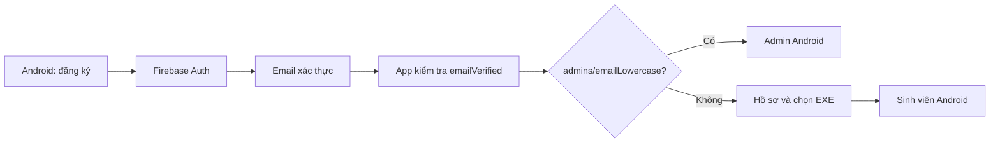
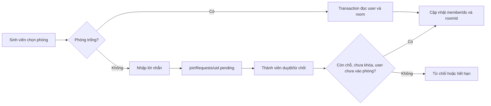
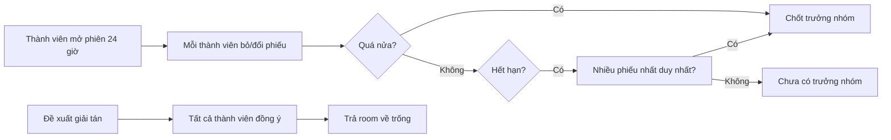
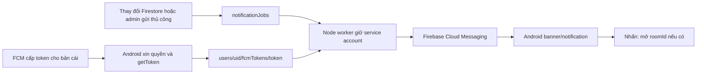
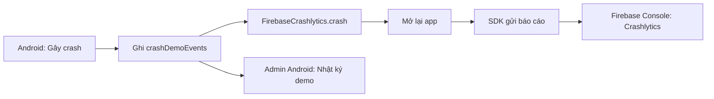
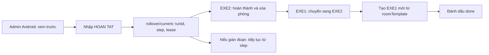

# Luồng trình bày Lab 3

Các sơ đồ này dùng cùng [đặc tả hiện hành](TEAMUP_SPEC.md). Mỗi mũi tên là một lời gọi hoặc thay đổi dữ liệu cần giải thích khi demo.

## 1. Đăng ký và phân quyền

Auth xác định tài khoản; tài liệu `admins` xác định vai trò. `firestore.rules` kiểm quyền ở máy chủ cho từng thao tác. Mã: `lib/core/router/app_router.dart`, `lib/features/admin/domain/admin_access_service.dart`, `firestore.rules`.

## 2. Tham gia phòng và yêu cầu

Transaction đọc lại dữ liệu khi ghi để tránh hai người cùng chiếm chỗ cuối. Mã: `lib/features/team/data/firebase_team_repository.dart`, `lib/features/team/domain/team_policy.dart`.

## 3. Bình chọn và giải tán

Phiếu được tính theo thành viên hiện tại. Mã: `lib/features/team/domain/team_policy.dart` và `lib/features/team/data/firebase_team_repository.dart`.

## 4. Token, push và nhận tin

Token gắn với bản cài, không phải UID. Worker tìm token của người nhận hoặc gửi topic phòng. Không nhúng service account trong APK. Mã: `lib/core/notifications/`, `push_worker/worker.js`, `push_worker/events.js`, `push_worker/message.js`.

## 5. Crashlytics demo

`crashDemoEvents` là dấu mốc demo; báo cáo crash thật ở Firebase Console. Mã: `lib/main.dart`, `lib/features/crash_demo/`.

## 6. Chuyển học kỳ

Mỗi bước có thể chạy lại, phòng tạo mới dùng ID theo `runId` để không bị nhân đôi. Lệnh chạy trong Flutter Android bằng Firestore transaction/batch; worker Node chỉ gửi FCM. Mã: `lib/features/admin/domain/rollover_engine.dart`, `lib/features/admin/data/firebase_admin_repository.dart`.
