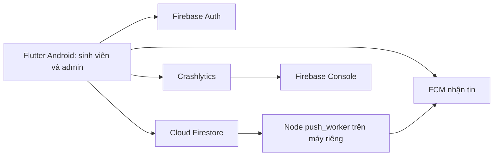

# TeamUp EXE — đặc tả hiện hành

Tài liệu này thay thế bản yêu cầu cũ có **admin web**, API Node cho chuyển học kỳ và upload ảnh. Chốt theo trao đổi đến ngày 06/11/2026: **một ứng dụng Flutter Android cho cả sinh viên và quản trị viên**; chấm trên điện thoại Android thật. Dự án Firebase `teamup-exe` dùng Auth email/mật khẩu, Cloud Firestore, Cloud Messaging và Crashlytics. Gói Spark, không dùng Cloud Functions. Upload ảnh/tệp nhóm để sau.

## 1. Kiến trúc và quyền

Sau xác thực email, app đọc `admins/{email viết thường}`. Có tài liệu này thì vào màn quản trị Android; sinh viên vào màn Phòng, Thông báo, Hồ sơ. Không có màn quản trị Web/Windows. Firestore Rules là lớp kiểm quyền dữ liệu; ẩn nút trên giao diện không thay thế Rules. Khóa service account chỉ ở máy chạy worker, tuyệt đối không nằm trong APK.

| Hành động | Admin Android | Thành viên phòng | Sinh viên chưa có phòng |
| --- | --- | --- | --- |
| Tạo/sửa/xóa phòng trống, mẫu phòng, sức chứa | Có | Không | Không |
| Xem trước, xác nhận và tiếp tục chuyển học kỳ | Có | Không | Không |
| Tạo thông báo, gửi push thủ công | Có | Không | Không |
| Vào phòng trống hoặc xin vào phòng có người | Không | Không | Có |
| Duyệt/từ chối yêu cầu, đổi tên phòng, bầu trưởng nhóm, đề xuất/duyệt giải tán | Không | Có | Không |
| Khóa/mở khóa phòng | Không | Chỉ trưởng nhóm | Không |
| Rời phòng kể cả đang khóa | Không | Có | Không |
| Xem phòng, thành viên, giới thiệu và kỹ năng | Có | Có | Có |

## 2. Dữ liệu Firestore

| Đường dẫn | Dữ liệu chính |
| --- | --- |
| `admins/{emailLowercase}` | dấu quyền admin, `addedAt` |
| `users/{uid}` | `name`, `email`, `bio`, `skills`, `serverId`, `roomId`, `status`, `pendingRequestIds` |
| `users/{uid}/fcmTokens/{token}` | `token`, `platform`, `createdAt`, `updatedAt` |
| `servers/{exe1\|exe2}` | `name`, `roomTemplate[]` |
| `rooms/{roomId}` | `serverId`, `name`, `defaultName`, `nameLower`, `capacity`, `memberIds[]`, `leaderId`, `locked` |
| `rooms/{roomId}/joinRequests/{uid}` | `createdAt`, `expiresAt`, `status`, `decidedBy`, `message` |
| `rooms/{roomId}/voteSession/current` và `ballots/{uid}` | thời hạn, trạng thái, người thắng, bản đồ phiếu và phiếu riêng |
| `rooms/{roomId}/disband/current` | người đề xuất, thời hạn, người đồng ý, trạng thái |
| `rollover/current` | lượt chạy, lease, bước và tiến độ |
| `announcements/{id}` | tin trong ứng dụng theo tất cả/EXE1/EXE2 |
| `notificationJobs/{id}` | lệnh push, loại/đích, trạng thái, lỗi/kết quả |
| `crashDemoEvents/{id}` | sự kiện demo gây crash hoặc lỗi không gây crash |
| `_workerState/{id}` | checkpoint nội bộ của worker cho thông báo tự động |

Trạng thái phòng suy ra theo thứ tự: đã khóa, đã đủ, đang mở, trống. Bộ kỹ năng: Backend, Frontend, Mobile, Database/SQL, UI/UX, DevOps, Kiểm thử, AI/ML, Quản lý dự án.

## 3. Luồng sinh viên

1. **Đăng ký:** email `@fpt.edu.vn` hoặc `@fe.edu.vn`, mật khẩu ít nhất 8 ký tự; gửi email xác thực. `ALLOW_ANY_EMAIL=true` chỉ dành cho bản debug. Chưa xác thực không vào dữ liệu ứng dụng.
2. **Hồ sơ:** nhập tên, giới thiệu bắt buộc tối đa 280 ký tự và ít nhất một kỹ năng. Sau đó chọn EXE1/EXE2. Tài khoản `completed` chỉ thấy thông báo hoàn thành và đăng xuất.
3. **Tìm phòng:** danh sách realtime theo server, tìm tên không phân biệt dấu/hoa; xem số thành viên, sức chứa, trạng thái, giới thiệu và kỹ năng của thành viên.
4. **Vào phòng trống:** transaction kiểm tra còn trống, chưa khóa/đủ, sinh viên chưa có phòng rồi cập nhật đồng thời phòng và hồ sơ. Phòng mới không có trưởng nhóm.
5. **Xin vào phòng có người:** nhập lời nhắn tùy chọn tối đa 280 ký tự; tối đa ba yêu cầu chờ, mỗi yêu cầu 48 giờ. Thành viên bất kỳ duyệt/từ chối. Khi duyệt, transaction kiểm tra lại phòng và tài khoản, cập nhật thành viên, hủy yêu cầu chờ khác. Yêu cầu đã từ chối/hủy/hết hạn có thể gửi lại.
6. **Bầu trưởng nhóm:** khi chưa có trưởng nhóm, thành viên mở phiên 24 giờ. Mỗi người một phiếu, đổi được và có thể tự bầu. Hơn nửa thành viên hiện tại thì thắng ngay; hết hạn chọn người có nhiều phiếu nhất, hòa hoặc không có phiếu thì chưa có trưởng nhóm. Khi người rời, phiếu liên quan bị bỏ. Phiên hết hạn được chốt khi mở phòng.
7. **Quản lý phòng:** mọi thành viên đổi tên, duyệt yêu cầu, rời phòng; chỉ trưởng nhóm khóa/mở. Trưởng nhóm rời thì bỏ quyền trưởng và có thể bầu lại. Người cuối rời thì tên về mặc định, phòng mở và dữ liệu phụ được dọn.
8. **Giải tán:** một người đề xuất và tính là đã đồng ý; tất cả thành viên phải đồng ý trong 24 giờ. Sau đó mọi người rời phòng, phòng về trạng thái trống.
9. **Gợi ý kỹ năng:** so kỹ năng nhóm với bộ chuẩn. Mặc định diễn đạt cục bộ; `USE_FIREBASE_AI=true` thử Firebase AI Logic/Gemini và tự dự phòng về logic cục bộ khi lỗi.

## 4. Luồng quản trị trên Android

- **Phòng:** xem EXE1/EXE2, tạo nhiều phòng mặc định, đổi tên, chỉnh sức chứa không thấp hơn số thành viên, xóa phòng trống, sửa mẫu phòng.
- **Học kỳ:** xem trước số người EXE2 hoàn thành, số phòng/người EXE1 chuyển, số phòng EXE1 tạo lại; gõ `HOAN TAT` để chạy. App xử lý theo thứ tự EXE2 hoàn thành → EXE1 lên EXE2 → tạo lại EXE1 từ mẫu. Dữ liệu `rollover/current` có lease và bước để tiếp tục sau gián đoạn. Lượt mới yêu cầu xác nhận `KY MOI`. Node worker **không** chạy chuyển học kỳ.
- **Thông báo:** viết tin trong app cho tất cả/EXE1/EXE2; gửi push thủ công tới một phòng, một server, một UID hoặc tất cả; xem `notificationJobs` để biết chờ/đã gửi/thất bại.
- **Nhật ký demo:** xem `crashDemoEvents`. Báo cáo Crashlytics thật xem bằng **Firebase Console**, không nằm trong Firestore hay màn admin.

## 5. FCM và Crashlytics

FCM cấp token cho từng bản cài. Sau đăng nhập, app xin quyền thông báo, lấy token, lưu tại `users/{uid}/fcmTokens/{token}`, cập nhật khi đổi, xóa khi đăng xuất. Client theo dõi topic `room_<id>` của phòng hiện tại cho push thủ công theo phòng. Worker dùng Firebase Admin SDK và service account để gửi; push theo sự kiện và theo server/UID/tất cả lấy token từ Firestore. Nội dung push không chứa bí mật vì topic không phải cơ chế phân quyền.

Worker theo dõi yêu cầu vào phòng, thay đổi thành viên/khóa, phiên bầu, đề xuất giải tán, chuyển EXE1/EXE2; tạo lệnh push tự động và lưu checkpoint. Sự kiện: `join_request`, `request_approved`, `request_rejected`, `member_changed`, `vote_started`, `vote_finished`, `room_lock`, `disband_proposed`, `disband_done`, `rollover_moved`, `rollover_done`. Hết hạn yêu cầu xử lý lười khi app đọc; sự kiện từ chối chỉ phát sau khi trạng thái thực sự thành `expired`. Worker phải chạy trên máy/server có mạng. Không có worker thì dữ liệu và màn hình realtime vẫn hoạt động, nhưng push chờ.

App đang mở hiển thị banner; khi nhấn thông báo có `roomId` thì mở phòng; handler nền được đăng ký ở cấp cao nhất. Android dùng kênh `teamup_notifications`. Màn `/debug-firebase` chỉ hiện trong bản debug để xem/copy FCM token, xin quyền, thử topic và smoke test Firebase.

Mục Demo Crashlytics trong Hồ sơ có **Ghi lỗi không gây crash** và **Gây crash**. Nút gây crash ghi `crashDemoEvents` trước khi gọi SDK. Mở lại ứng dụng và chờ báo cáo hiện ở Firebase Console. Cần demo trên điện thoại thật.

## 6. Bảo mật, kiểm thử và tiêu chí bàn giao

`firestore.rules` kiểm email đã xác thực, quyền admin và các thao tác phòng/yêu cầu/bầu/giải tán. Client dùng transaction để kiểm tra lại dữ liệu khi nhiều máy thao tác cùng lúc; batch chuyển học kỳ giới hạn 400 ghi. Rules chưa thay thế được backend đáng tin cậy cho toàn bộ bất biến liên tài liệu: giới hạn ba yêu cầu và kết quả bầu có thể bị client sửa đổi gian lận. Xem [SECURITY.md](SECURITY.md) để kiểm thử Emulator và rủi ro cụ thể. Không tự triển khai Rules hay dùng tài khoản Google của người dùng từ mã.

Hoàn thành để chấm khi: APK Android build/chạy trên **điện thoại thật**; hai tài khoản sinh viên thấy thay đổi realtime và tranh chỗ cuối đúng; yêu cầu/phiếu/giải tán/khóa hoạt động; admin Android quản lý phòng và chuyển kỳ với dữ liệu thử; worker gửi push foreground/background/nhấn mở phòng; Crashlytics hiện trong Console sau khi mở lại; Rules được thử bằng Emulator và triển khai; `flutter analyze`, `flutter test`, `npm test` đều đạt. Hiện các tiêu chí cần Firebase/thiết bị thật chỉ có thể xác minh sau khi SDK Android NDK được sửa và cấu hình Rules/worker trên máy demo.

## 7. Vị trí mã để giải thích khi chấm Lab 3

| Câu hỏi | Vị trí mã |
| --- | --- |
| Ai cấp FCM token, client lưu/cập nhật/xóa thế nào? | `lib/core/notifications/notification_service.dart`, `firebase_notification_adapters.dart`, `notification_runtime.dart` |
| Server gửi FCM ra sao? | `push_worker/worker.js`, `message.js`, `events.js` |
| Transaction tham gia, duyệt, bầu, giải tán ở đâu? | `lib/features/team/data/firebase_team_repository.dart`, `domain/team_policy.dart` |
| Chuyển học kỳ và tiếp tục sau lỗi ở đâu? | `lib/features/admin/data/firebase_admin_repository.dart`, `domain/rollover_engine.dart` |
| Crashlytics hoạt động thế nào? | `lib/main.dart`, `lib/features/crash_demo/` và Firebase Console |
| Quyền dữ liệu được kiểm ở đâu? | `firestore.rules` |

Upload ảnh/tệp nhóm chưa thuộc phạm vi hiện tại. Nếu bổ sung sau, có thể dùng Cloudinary hoặc AWS S3 với khóa bí mật nằm ở server; chưa chọn dịch vụ hoặc thêm dependency.
